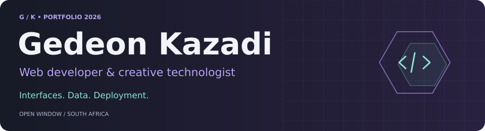
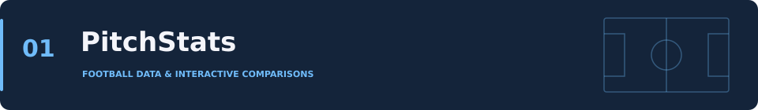
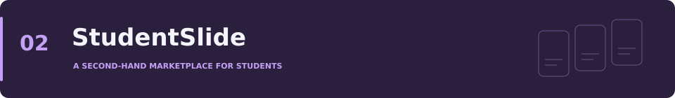
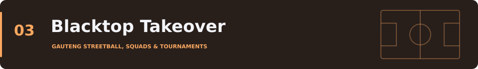
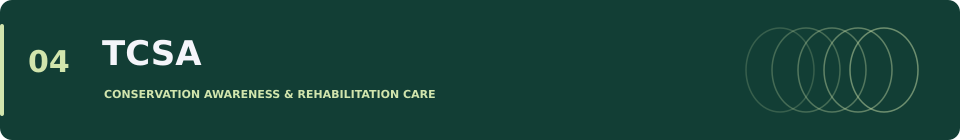
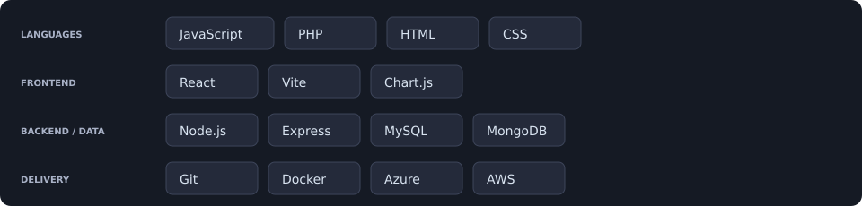
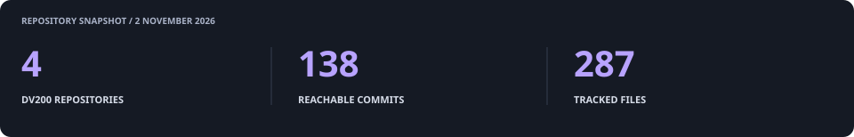

  

  <a href="#portfolio-2026">Portfolio</a> ·
  <a href="#what-i-build">Skills</a> ·
  <a href="#technology">Technology</a> ·
  <a href="#github-activity">GitHub activity</a> ·
  <a href="mailto:21100471@virtualwindow.co.za">Contact</a>

## About me

I'm **Gedeon Kazadi**, an Interactive Development student at **Open Window**, based in South Africa. I build web applications from the interface through to the database and deployment.

My work brings together interests in sport, community and practical tools. I enjoy giving a project its own visual identity, then working out how the data and user journeys should fit together. Alongside web development, I experiment with physical computing and micro-robotics.

## Portfolio 2026

Four core DV200 projects, organised by semester. Each project explores a different part of building for the web.

### Semester 1

**PitchStats** helps users compare Premier League players through interactive charts. It combines player search, head-to-head statistics and a simulated season timeline.

**Built with:** React · JavaScript · Chart.js · API-SPORTS  
**Focus:** API integration, data visualisation and responsive interfaces.

[Open live app ↗](https://dv200-football-dashboard.vercel.app/)

**StudentSlide** is a group-built marketplace for students to buy, sell and trade second-hand items. The application brings together listings, accounts and administrative review.

**Built with:** MongoDB · Express · React · Node.js  
**My role:** Admin Manager in a four-person team.

[View group repository ↗](https://github.com/gabri3llp/dv200_keyboardlickers_studentslide)

### Semester 2

**Blacktop Takeover** connects player registration, squad management, tournament applications, fixtures and results in one relational system. Its visual identity draws on Gauteng streetball culture.

**Built with:** PHP · MySQL / MariaDB · HTML · CSS · JavaScript  
**Focus:** Role-based journeys, tournament operations and database design.

[View repository ↗](https://github.com/GKaz17/blacktop-takeover-dv)

**TCSA Rehabilitation Platform** pairs a public conservation website with a private staff workspace for animal admissions, case notes, care tasks and reports. The full application is hosted separately on Azure and AWS.

**Built with:** React · Vite · PHP · MySQL · Azure · AWS  
**My work:** Development, staff dashboard redesign, integration and deployment. The public website builds on the supplied **Group 11 UX200 handoff**, credited in the project.

[View repository ↗](https://github.com/GKaz17/tcsa-rehabilitation-platform) ·
[Open Azure app ↗](https://tcsa-rehabilitation-gkaz17-hebyf0hnd4cze8cb.southafricanorth-01.azurewebsites.net/) ·
[Open AWS app ↗](https://tc-5b0e1ccaba9046b1b3cc6359db12c230.ecs.eu-north-1.on.aws/)

## What I build

| Area | Experience shown in my work |
| --- | --- |
| Interfaces | React components, routing, forms, responsive layouts and Chart.js visualisations |
| Server-side features | PHP APIs, Express services, validation and persistent CRUD journeys |
| Data | MySQL relational modelling, ERDs, prepared queries and MongoDB applications |
| Authentication | Sessions, password hashing, protected routes and role-based access |
| Deployment | React/PHP/MySQL on Azure and AWS; MERN deployment on Heroku |
| Measurement | Google Analytics 4, Search Console, metadata and indexing |

## Technology

## Beyond the four projects

- [Football Formation Authentication](https://github.com/GKaz17/football-auth) — a MERN creative-authentication project used in our Heroku deployment presentation.
- [Autonomous Rover](https://github.com/GKaz17/Autonomous-Rover-Creative-Computing) — physical computing and micro-robotics work.

## GitHub activity

The follower snapshot is dated **30 October 2026**. Explore my profile for current activity:

[Contributions and activity ↗](https://github.com/GKaz17?tab=overview) ·
[Public repositories ↗](https://github.com/GKaz17?tab=repositories)

## Get in touch

**Gedeon Kazadi** · South Africa  
[21100471@virtualwindow.co.za](mailto:21100471@virtualwindow.co.za) · [GitHub @GKaz17](https://github.com/GKaz17)

